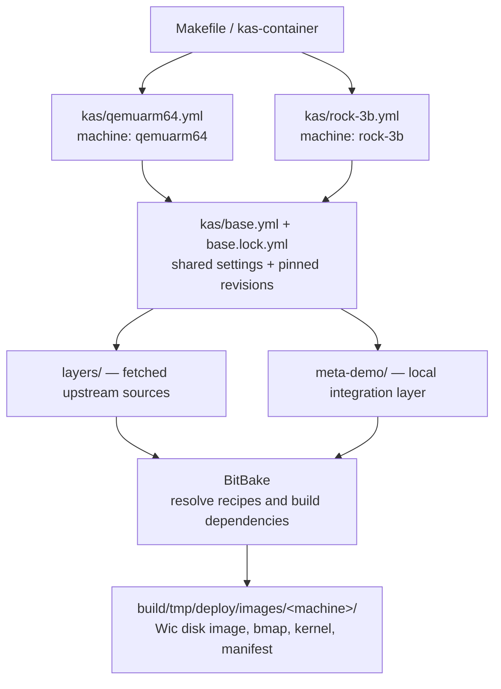
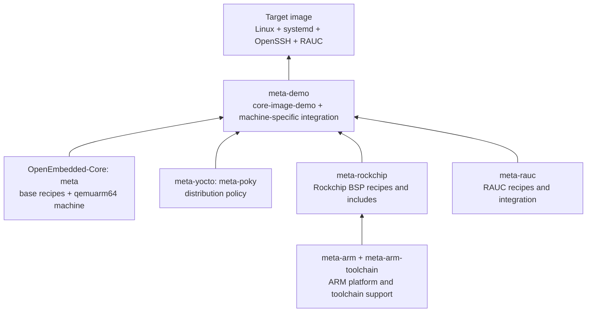
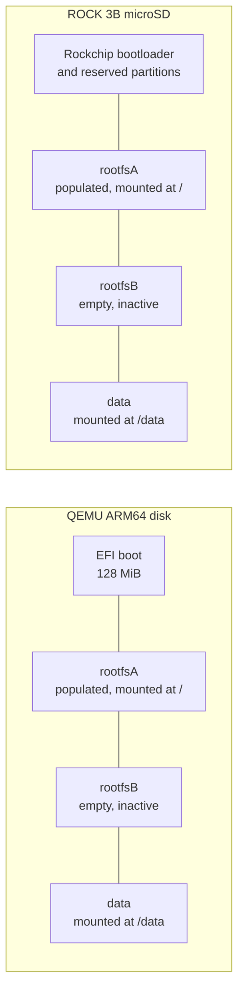

# ARM64 RAUC demo

Yocto Wrynose (6.0.4 LTS) demo with systemd, SSH and RAUC. QEMU ARM64 is the
default target; the Radxa ROCK 3B configuration is unvalidated. Both images
have rootfs A, an empty rootfs B, and a data partition.
QEMU also has an EFI boot partition; ROCK 3B has Rockchip bootloader partitions.

## Architecture and layers

kas selects a machine, checks out the revisions in `kas/base.lock.yml`, and
configures BitBake. Both targets include `kas/base.yml`, which selects the
Poky distribution, systemd, RAUC support and the `core-image-demo` target.



Yocto layers contribute recipes and configuration to one build; they are not
separate runtime services. `meta-demo` combines the upstream components and
adds this demo's image, machine configuration, recipe overrides and disk layouts.



All of these layers are enabled by the shared configuration, including the
Rockchip layers for QEMU. The local `rock-3b.conf` uses the BSP's RK3568 include;
QEMU uses the upstream `qemuarm64` machine. Local `.bbappend` files supply fstab,
RAUC configuration/keyring and the ROCK 3B kernel compatibility setting.

## Runtime and disk layout

Both Wic layouts populate rootfs A, reserve an empty ext4 rootfs B, and mount
the data partition at `/data`. RAUC identifies slots by GPT partition label.
The boot areas differ by target:



Rootfs partitions request 1024 MiB each and data requests 256 MiB; Wic can
grow them to fit their contents. QEMU's runner loads the kernel directly and
selects `/dev/vda2`; ROCK 3B uses U-Boot. Both pass `rauc.slot=A` and configure
RAUC's `noop` backend. These are boot smoke-test images: the partition layout
provides space for A/B updates, but boot selection, rollback and signed update
bundles still need integration.

## Build and run

Requires Linux, Git, Make, a running Docker (or Podman), and `kas-container`
on your PATH. Run as your normal user with access to the container engine.
Allow plenty of disk space (about 100 GB) and time for the first build.
For Podman, set `KAS_CONTAINER_ENGINE=podman`.

```sh
make build       # fetch pinned layers and build core-image-demo
make run         # boot with software emulation and user-mode networking
```

Log in as `root` with no password. Exit QEMU with **Ctrl-A, X**.
The QEMU image enables passwordless root for testing only.
`make run` uses a snapshot: guest changes are discarded when QEMU exits.
The emulator is built without SDL/OpenGL/audio support for this serial-only demo.

Inside the guest:

```sh
cat /proc/cmdline
mount
rauc status
```

The kernel command line selects RAUC slot A. This is a build/boot smoke test;
RAUC uses its `noop` bootloader backend. Automatic A/B switching and signed
update bundles are not configured. The QEMU runner loads the kernel directly;
it does not test the EFI boot chain. `rauc status` may warn that `noop` cannot
report the primary slot.

Outputs: `build/tmp/deploy/images/qemuarm64/` (`core-image-demo-qemuarm64.rootfs.wic`
and its `.wic.bmap`, plus the kernel and QEMU configuration).

```sh
make checkout    # fetch layers without building
make shell       # open the BitBake environment
make clean       # remove build output, keeping downloads and sstate
make help
```

Equivalent build command: `kas-container build kas/qemuarm64.yml`.
Override the executable with `make KAS_CONTAINER=/path/to/kas-container build`.
The installed package list is in
`build/tmp/deploy/images/qemuarm64/core-image-demo-qemuarm64.rootfs.manifest`.
Inside `make shell`, use `bitbake-getvar -r core-image-demo IMAGE_INSTALL` or
`bitbake-getvar -r core-image-demo IMAGE_FEATURES` to inspect resolved settings.

ROCK 3B microSD test:

```sh
make build-rock3b
```

Output: `build/tmp/deploy/images/rock-3b/core-image-demo-rock-3b.rootfs.wic`
and its `.wic.bmap`. Use a spare microSD card of at least 4 GB. Identify the
card with `lsblk`, unmount its mounted partitions, and write the whole card
(replace `/dev/sdX` with the card device, not a partition; this erases it):

```sh
sudo bmaptool copy build/tmp/deploy/images/rock-3b/core-image-demo-rock-3b.rootfs.wic /dev/sdX
sync
```

Insert the card with the board powered off. For the initial test, remove other
removable boot media. Existing SPI firmware can still take priority; inspect
the serial boot log if the board starts another OS.
Connect Ethernet and a 3.3 V USB UART adapter, using the ROCK 3B debug UART
pinout (connect GND, cross TX/RX, leave the adapter's power pin disconnected).
Open the console at **1500000 baud, 8N1, no flow control**, then power on:

```sh
picocom -b 1500000 /dev/ttyUSB0
```

See [Radxa's serial console guide](https://wiki.radxa.com/Rock3/dev/serial-console)
for wiring. Log in as `root` without a password (temporary demo access, as in
QEMU). Test:

```sh
tr -d '\000' < /proc/device-tree/model; echo
cat /proc/cmdline
mount
ip addr
systemctl --failed --no-pager
rauc status
```

Expect `Radxa ROCK 3B`, rootfs A, and `/data` mounted. RAUC uses `noop` here too;
this does not test A/B switching or rollback. The configuration uses U-Boot
and Linux from the Wrynose BSP. The ROCK 3B build is deferred and has not been
validated after the Wrynose upgrade; serial-console testing on the board is
also required.

`make shell-rock3b` opens its build environment. `make run` remains QEMU-only.
The build directory and caches are shared; do not build both targets at once.
`kas/base.yml` sets `BB_HASHSERVE_DB_DIR = "${SSTATE_DIR}"` so the hash-equivalence
database shares the sstate cache location across builds rather than living in
one build directory. With kas-container's shared `/sstate` mount, both persist
in that mount.

Repository contents:

- `Makefile`, `README.md`, `.gitignore`: commands, instructions and ignore rules.
- `kas/`: build configurations and the commit lockfile. Keep the lockfile for
  reproducible layer checkouts; `rock-3b.yml` retains the hardware configuration.
- `meta-demo/`: our Yocto layer, image recipe, disk layout, machine-specific
  fstab/RAUC settings and the public test keyring required by the image.

kas downloads OpenEmbedded-Core, BitBake, meta-yocto and the external layers
under `layers/`. These are ignored local checkouts, not submodules. All are
pinned in `kas/base.lock.yml`. Build output, caches and kas shell history are
also ignored. Wrynose build output is under `build/`.
`pki/` is unused local signing material and is excluded; the image uses
`meta-demo/recipes-core/rauc/files/keyring.pem`. Do not commit generated images
or private keys.
